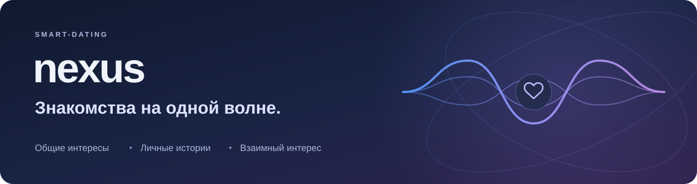

# Nexus · Документация

**Продукт, требования и устройство работающего приложения.** Nexus помогает совершеннолетним людям находить повод для знакомства через общие интересы и личные истории. Подробный рассказ используется для подбора и остаётся доступен только автору; разговор начинается после взаимной симпатии.

[Запустить приложение](RUNBOOK.md) · [Изучить архитектуру](architecture/system-architecture.md) · [Открыть ER-диаграмму](diagrams/ERD.md) · [Посмотреть API](architecture/api-contracts.md)

## С чего начать

| Задача | Документ |
| --- | --- |
| Понять, для кого создаётся Nexus и какую проблему решает | [Бизнес-требования](requirements/business-requirements.md) |
| Разобраться в терминах и границах продукта | [Глоссарий](requirements/glossary.md) и [состояние реализации](STATUS.md) |
| Пройти путь пользователя | [Сценарии использования](requirements/use-cases.md) |
| Узнать правила и критерии приёмки | [Функциональные](requirements/functional-requirements.md) и [нефункциональные требования](requirements/non-functional-requirements.md) |
| Проследить связь целей с реализацией и проверками | [Матрица требований](requirements/traceability.md) |
| Изучить устройство приложения и данных | [Архитектура](architecture/system-architecture.md), [ERD](diagrams/ERD.md), [словарь данных](architecture/data-dictionary.md), [диаграммы](diagrams/README.md) |
| Подключить клиент или изменить подбор | [REST API](architecture/api-contracts.md) и [смысловая модель](architecture/MODEL.md) |
| Запустить, проверить или восстановить приложение | [Инструкция запуска](RUNBOOK.md), [проверки](TESTING.md), [работа с данными](privacy/data-handling.md) |
| Понять интерфейс и процесс разработки | [Первое знакомство](design/onboarding.md), [интерфейс](design/interface.md), [команда](team/roles.md), [порядок работы](team/workflow.md) |

## Продукт в одном сценарии

1. Пользователь создаёт аккаунт, выбирает интересы и заполняет основные сведения.
2. Отвечает на вопросы Некса либо пишет свободный рассказ, проверяет текст и сохраняет его. Добавляет хотя бы одну фотографию.
3. Смотрит анкеты: сначала из своего города, затем из других; внутри каждой группы — по сходству рассказов. Низкий процент не исключает анкету.
4. Выражает симпатию или пропускает человека. Встречные симпатии открывают чат.
5. Управляет своими фотографиями, видимостью анкеты, блокировками и данными.

Некс задаёт подготовленные вопросы по выбранным темам. Это интерфейсный помощник, а не генеративный собеседник. Процент сходства характеризует тексты и не является прогнозом отношений.

## Репозитории

| Репозиторий | Ответственность |
| --- | --- |
| [nexus-frontend](https://github.com/SMART-DATING/nexus-frontend) | React-приложение: главная, регистрация, анкеты, личные истории, галереи и чаты |
| [nexus-backend](https://github.com/SMART-DATING/nexus-backend) | Spring Boot API, доступ к данным, смысловой подбор и обработка изображений |
| [nexus-docs](https://github.com/SMART-DATING/nexus-docs) | Описание продукта, контракты, схемы и инструкции |
| [.github](https://github.com/SMART-DATING/.github) | Публичная страница организации |

Текущая версия — работающий веб-прототип. Состав реализованных функций и ограничения приведены в [STATUS.md](STATUS.md); будущие изменения — в [плане развития](roadmap.md). Коммерческая модель и постоянное публичное размещение пока не определены.

Документы сверены с исходниками `main` 14 октября 2026 года. [Версии и правила актуализации](BASELINE.md). История прежних редакций доступна в Git.
