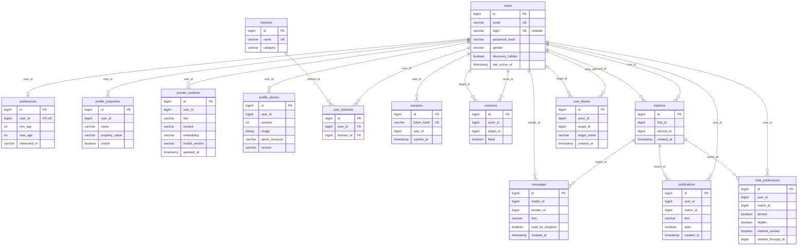

# ER-диаграмма

Схема охватывает **14 текущих таблиц**. Связи — логические отношения предметной области; метка FK стоит только у реально объявленных JPA-внешних ключей: preferences.user_id и двух связей user_interests. Повторные линии reactions, matches и user_blocks различают роли двух участников.

Диаграмма содержит основные рабочие поля. Прежние avatar_key/avatar_image/avatar_version/gallery_migrated сохранены в users для совместимости и подробно описаны в [словаре данных](../architecture/data-dictionary.md). Отдельных таблиц профиля, чата и рекомендации нет.

Обозначения: PK — первичный ключ, UK — одиночная уникальность, FK — физическая ссылка. Составные UK: profile_properties(user_id,name), user_interests(user_id,interest_id), reactions(actor_id,target_id), matches(first_id,second_id), user_blocks(actor_id,target_id), chat_preferences(user_id,match_id).

У preferences физически допустимо не более одной строки на аккаунт; сервис создаёт её при регистрации и восстанавливает для прежнего аккаунта при обращении. Чат-настройка создаётся по действию; отсутствие строки означает значения по умолчанию. Ограничения количества фото/историй и корректности прочих ID проверяются кодом, а не всеми необходимыми FK/CHECK в БД.

[Словарь всех полей и ограничений](../architecture/data-dictionary.md) · [JPA-сущности](https://github.com/SMART-DATING/nexus-backend/tree/main/src/main/java/ru/nexus/entity)

[Открыть SVG](assets/ERD.svg) · [Открыть PNG](assets/ERD.png)

## Исходник Mermaid

Показать редактируемую схему

