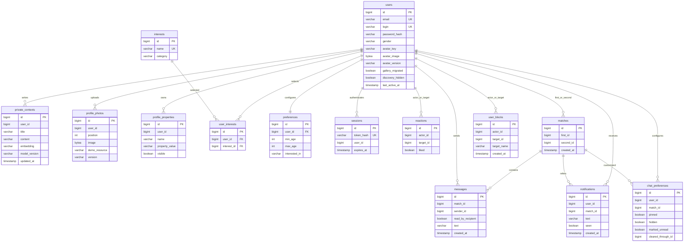

# Актуальная логическая ERD

В текущей базе 14 предметных/служебных таблиц, каждая соответствует JPA-сущности. Уникальны email, nullable login, имя интереса, preferences.user_id, пары profile_properties(user_id,name), user_interests(user_id,interest_id), reactions(actor_id,target_id), matches(first_id,second_id), user_blocks(actor_id,target_id), chat_preferences(user_id,match_id).

Актуальная схема — Mermaid выше. `ERD.png` сохранён как прежний снимок схемы до добавления блокировок и настроек чата; он не является текущей ERD.

UserInterest имеет физические FK к UserAccount и Interest, Preference — FK к UserAccount. Остальные связи представлены ID и проверяются сервисом; удаления сущностей в API нет. Перед добавлением удаления нужны полные FK и политика каскадов.

В ранее созданной базе могут остаться старые user_account_interests и users.min_age/max_age. CatalogueData переносит их значения в новые сущности; старые данные сохраняются для восстановления и не являются текущей моделью. Отдельной таблицы Profile нет; фото — profile_photos, личный текст и его версионированный вектор — private_contexts. EmbeddingVector и Recommendation отдельными таблицами не представлены. Исходные avatar_image/avatar_version сохраняются для совместимости после переноса в галерею.
