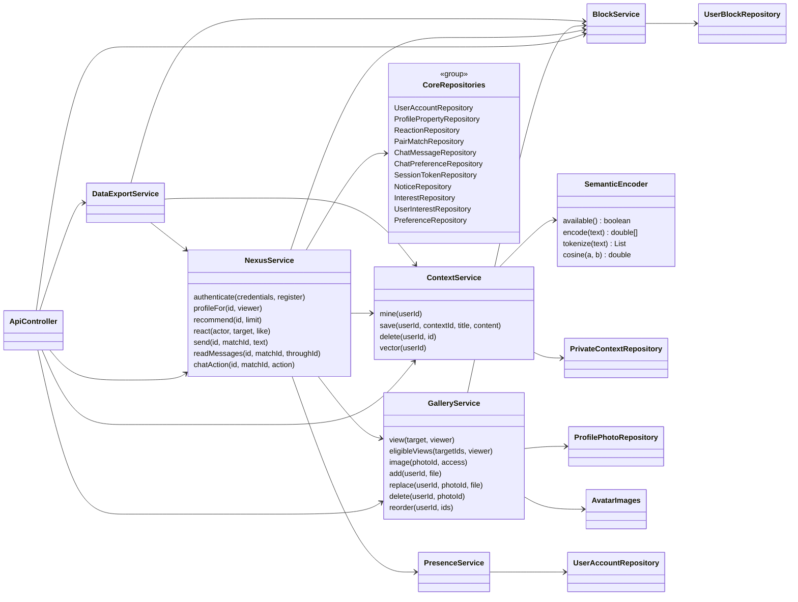

# UML основных сервисов

Диаграмма показывает выбранный срез зависимостей backend, а не исчерпывающую сигнатуру каждого класса. CoreRepositories — группа существующих репозиториев, не класс исходников. Зависимости экспорта от репозиториев и часть служебных связей опущены для читаемости. Названия показанных методов сверены с кодом.

Клиентские компоненты и их ответственность перечислены в [README frontend](https://github.com/SMART-DATING/nexus-frontend#структура-клиента). Сущности и кардинальности вынесены в [ERD](ERD.md).

[Сервисы backend](https://github.com/SMART-DATING/nexus-backend/tree/main/src/main/java/ru/nexus/service) · [Архитектура](../architecture/system-architecture.md)

[Открыть SVG](assets/UML.svg) · [Открыть PNG](assets/UML.png)

## Исходник Mermaid

Показать редактируемую схему

