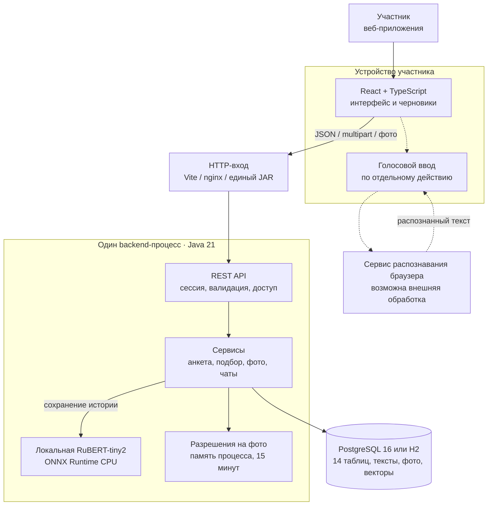

# Контейнеры и границы системы

Схема показывает фактические границы исполнения. ONNX — библиотека внутри Java, не отдельный HTTP-сервис. H2 и PostgreSQL — альтернативные режимы хранения; они не используются одновременно одной конфигурацией. Vite/nginx/встроенная раздача также представляют варианты запуска.

[Описание архитектуры](../architecture/system-architecture.md) · [Запуск](../RUNBOOK.md)

[Открыть SVG](assets/architecture.svg) · [Открыть PNG](assets/architecture.png)

## Исходник Mermaid

Показать редактируемую схему

