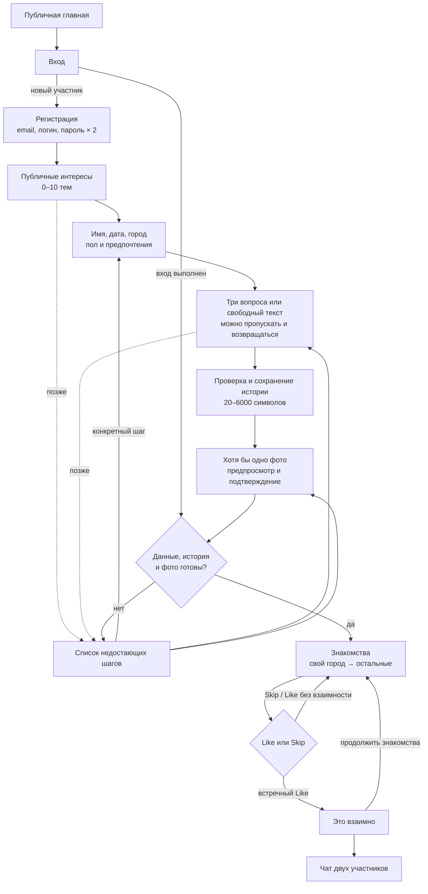

# Путь пользователя

Схема отражает основной путь интерфейса и возможность отложить подготовку. Готовность в UI требует основных сведений, сохранённой истории и хотя бы одного фото. Checklist направляет к конкретному недостающему шагу; сохранённые данные не удаляются при пропуске дальнейшего заполнения.

[Сценарии UC-01–UC-10](../requirements/use-cases.md) · [Первое знакомство](../design/onboarding.md)

[Открыть SVG](assets/journey.svg) · [Открыть PNG](assets/journey.png)

## Исходник Mermaid

Показать редактируемую схему

