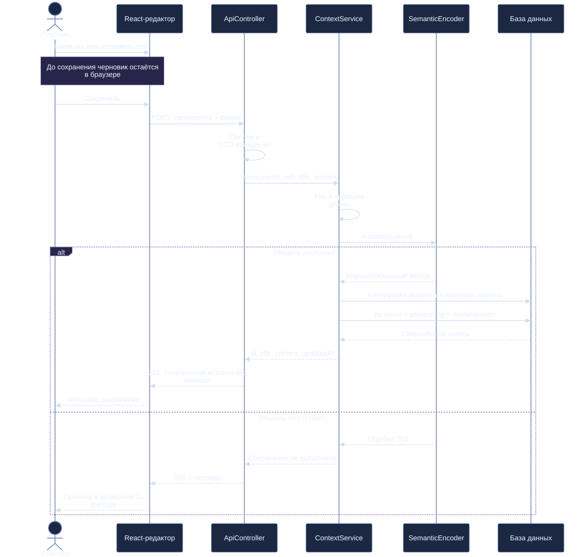
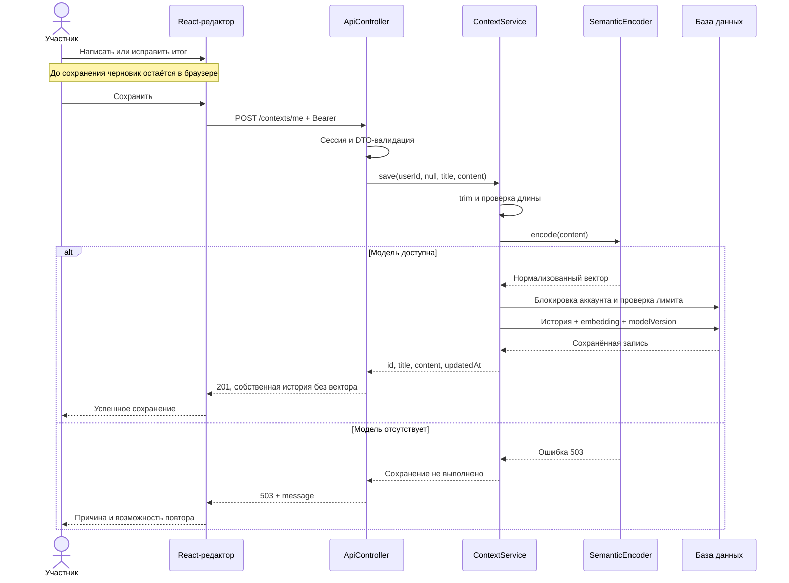
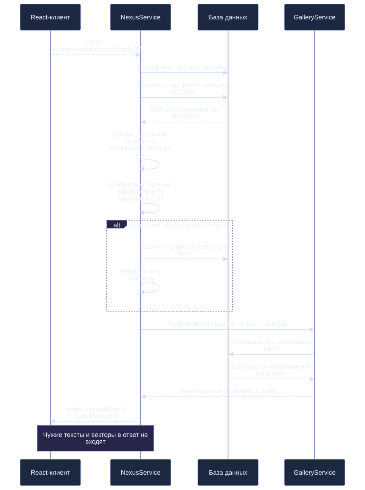
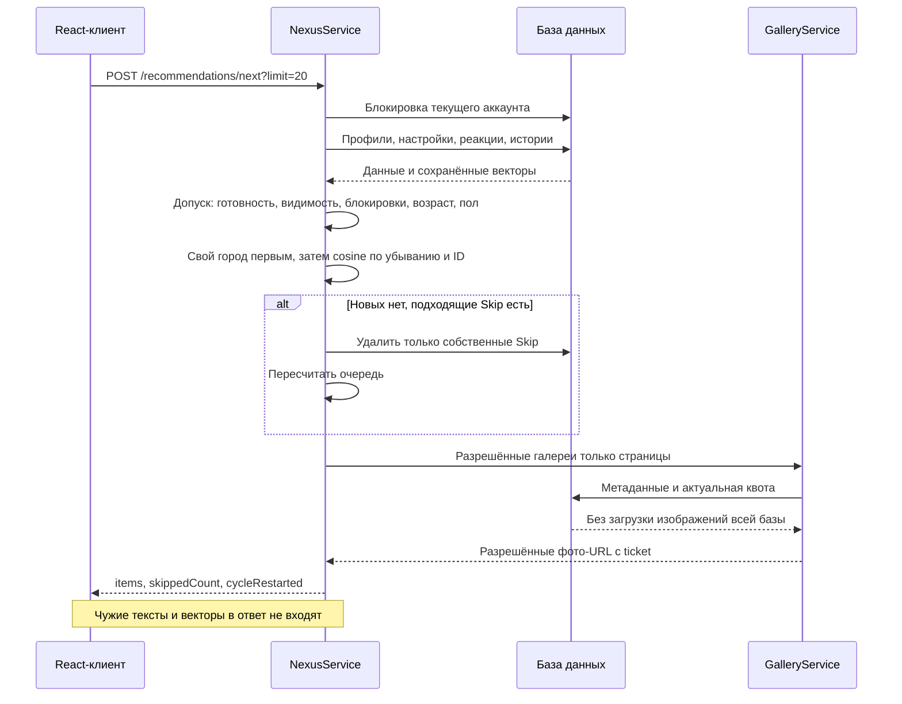
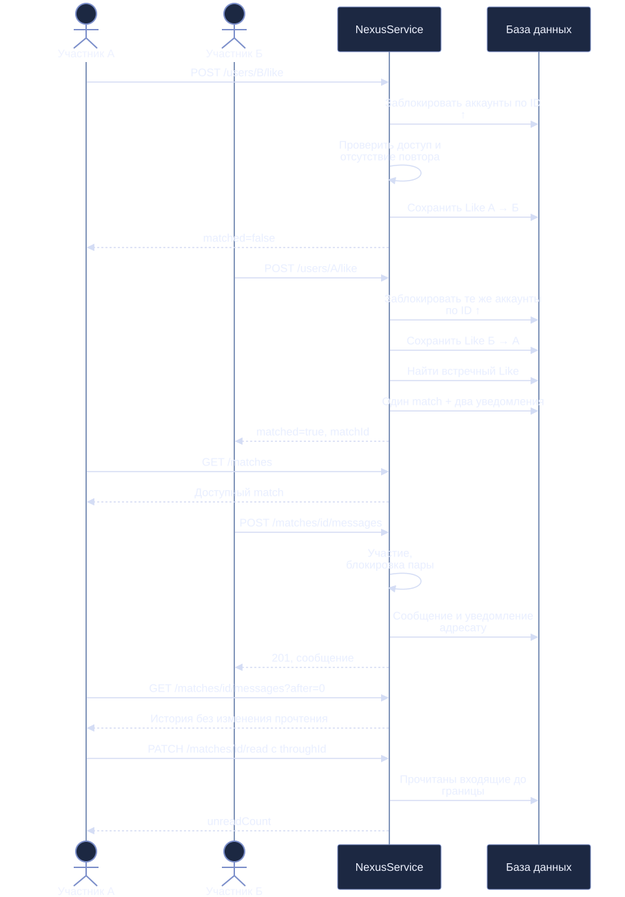
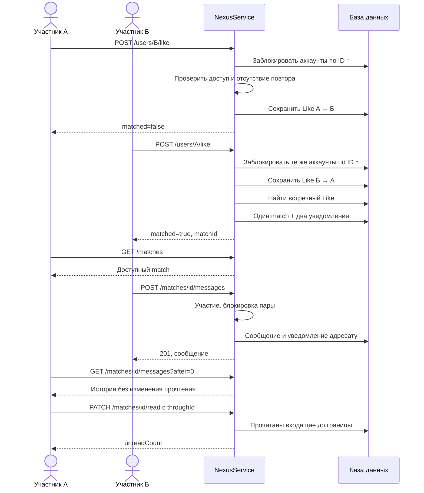

# Последовательности основных операций

Схемы описывают фактическую последовательность сервисов. Защищённые запросы проходят проверку сессии; транзакционные границы и ошибки уточняются в [архитектуре](../architecture/system-architecture.md) и [API](../architecture/api-contracts.md).

## Сохранение истории

[SVG](assets/story-sequence.svg) · [PNG](assets/story-sequence.png)

Исходник Mermaid

## Следующая подборка

[SVG](assets/recommendation-sequence.svg) · [PNG](assets/recommendation-sequence.png)

Исходник Mermaid

## Взаимность и сообщение

[SVG](assets/match-sequence.svg) · [PNG](assets/match-sequence.png)

Исходник Mermaid

