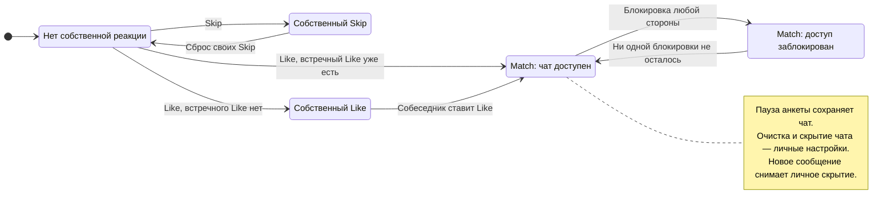

# Состояния реакции и доступа

Это модель наблюдаемого поведения, а не перечисление значений одного столбца status. Реакции хранятся в reactions, взаимность — в matches, запрет доступа — в user_blocks. Блокировка возможна и до match; на схеме показана только её роль для существующей переписки. Разблокировка не сбрасывает реакции и не удаляет историю.

Пауза анкеты и личные настройки чата ортогональны взаимности: они не превращают Like в Skip и не удаляют match. Полное правило видимости — в [данных и доступе](../privacy/data-handling.md).

[Открыть SVG](assets/states.svg) · [Открыть PNG](assets/states.png)

## Исходник Mermaid

Показать редактируемую схему

